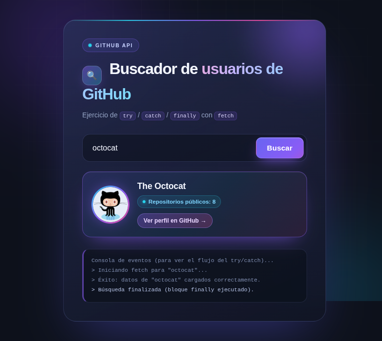

# 🔍 Buscador de usuarios de GitHub

<p align="center">
  <strong>Aplicación web que consulta la API pública de GitHub y muestra el perfil de cualquier usuario.</strong><br />
  Proyecto educativo para practicar <code>try / catch / finally</code> con <code>fetch</code> y <code>async / await</code>.
</p>

<p align="center">
  
  
  
  
</p>

<p align="center">
  
</p>

---

## ✨ Características

- 🔎 Búsqueda de usuarios por nombre de usuario de GitHub.
- 👤 Muestra avatar, nombre, repositorios públicos y enlace al perfil.
- ⚡ Peticiones con `fetch` y `async / await`.
- 🛡️ Manejo de errores con `try / catch / finally`.
- 🧹 Validación del campo vacío antes de consultar la API.
- ⏳ Indicador de carga y bloqueo del botón mientras se realiza la petición.
- ⌨️ Búsqueda también con la tecla **Enter**.
- 🧾 Consola de eventos en pantalla para ver el flujo de ejecución.
- 📱 Diseño responsive para móvil, tablet y escritorio.
- 🎨 Interfaz oscura con fondo animado, glassmorphism, gradientes y microanimaciones.
- ♿ Respeta `prefers-reduced-motion` y mejora la visibilidad del foco.

## 🚀 Cómo funciona

1. Se obtiene el nombre de usuario y se eliminan los espacios sobrantes con `trim()`.
2. Si el campo está vacío, se muestra un mensaje de validación.
3. Se deshabilita el botón y se muestra el estado de carga.
4. Dentro del bloque `try`, se consulta la API de GitHub.
5. Si la respuesta no es correcta (`!respuesta.ok`), se lanza un error con `throw`.
6. El bloque `catch` captura el error y lo muestra en pantalla.
7. El bloque `finally` oculta la carga y vuelve a habilitar el botón siempre.

```js
try {
  const datos = await buscarUsuario(username);
  // Renderizar los datos del usuario
} catch (error) {
  // Mostrar el error capturado
} finally {
  // Ocultar la carga y rehabilitar el botón
}
```

## 🔌 API utilizada

Se consume el endpoint público de usuarios de GitHub:

```http
GET https://api.github.com/users/{username}
```

Campos utilizados de la respuesta:

| Campo          | Uso                          |
| -------------- | ---------------------------- |
| `avatar_url`   | Imagen de perfil             |
| `name`         | Nombre del usuario           |
| `login`        | Alternativa si no hay nombre |
| `public_repos` | Número de repositorios       |
| `html_url`     | Enlace al perfil de GitHub   |

> La API pública sin autenticación tiene un límite de 60 peticiones por hora.

## 🛠️ Tecnologías

- **HTML5** — estructura semántica.
- **CSS3** — Flexbox, media queries, gradientes, glassmorphism, animaciones y `backdrop-filter`.
- **JavaScript (Vanilla)** — `fetch`, `async / await`, `try / catch / finally` y manipulación del DOM.
- **GitHub REST API** — datos de los usuarios.

No requiere frameworks, dependencias ni proceso de compilación.

## 📁 Estructura del proyecto

```text
Buscador-Git/
├── index.html          # Aplicación completa (HTML, CSS y JavaScript)
├── README.md           # Documentación del proyecto
└── assets/
    └── preview.png     # Vista previa de la interfaz
```

## ▶️ Cómo ejecutarlo

### Opción 1: abrir directamente

Abre `index.html` en tu navegador.

### Opción 2: servidor local

```bash
# Con Python 3
python3 -m http.server 8000

# Luego abre:
# http://localhost:8000
```

## 🧪 Pruebas rápidas

| Caso                          | Resultado esperado                              |
| ----------------------------- | ----------------------------------------------- |
| `octocat`                     | Muestra el perfil de The Octocat                |
| Campo vacío                   | Mensaje: “Por favor escribe un nombre de usuario” |
| Usuario inexistente           | Mensaje de error con el código HTTP             |
| Pulsar **Enter** en el campo  | Ejecuta la búsqueda                             |

## 👨‍💻 Autor

**Carlos Delgado**

- GitHub: [@CarlosDelgado22](https://github.com/CarlosDelgado22)
- Repositorio: [Buscador-Git](https://github.com/CarlosDelgado22/Buscador-Git)

---

<p align="center">
  Proyecto con fines educativos · Hecho con HTML, CSS y JavaScript 💜
</p>
